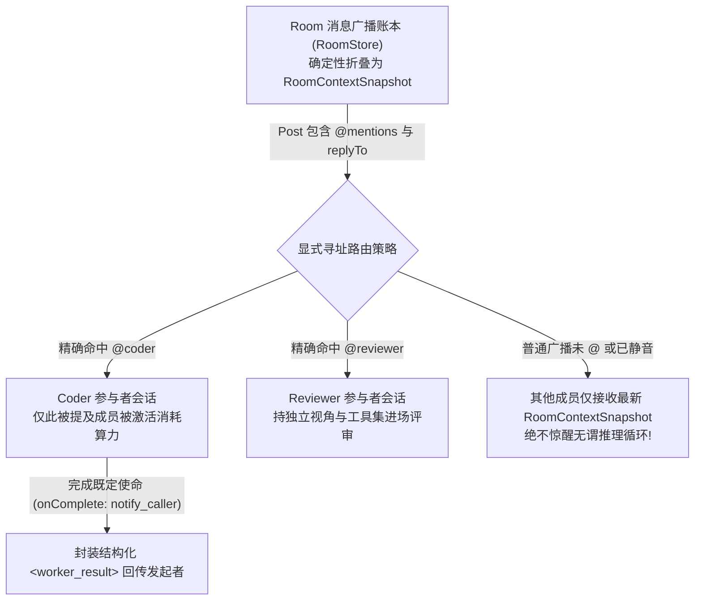

# Rooms 多智能体协同与对称会话工具：告别黑盒 Subagent 调用

## 1. 为什么单向“函数调用式 Subagent”在大规模协作中一定会撞墙？

早期的多 Agent 架构普遍把“主 Agent 派生子 Agent”当成一次普通 RPC 工具调用（比如 `dispatch_subagent(prompt)` -> 同步阻塞等一段黑盒字符串返回）。这种单向主从模式在复杂任务面前很快暴露出四重尴尬缺陷：

1. **黑盒瞎等与过程失明**：子任务一旦卡在某个编译错误或需要澄清需求，父会话什么都看不见，只能死等到超时报错，浪费了之前 80% 已经建立起来的推导成果。
2. **平级对话无门**：如果一个架构师 Agent、一个后端开发 Agent 和一个安全审计 Agent 需要围在一起互相审阅讨论、互相 `@` 指派局部复核，传统的单向“父 -> 子”树形调用模型根本表达不出平坦的多方群聊（Multi-Party Collaboration）拓扑。
3. **非对称工具语义增加模型认知负担**：父级有自己的工具套，普通会话是另一套创建接口，后台恢复又是一套管理指令，模型不得不去记忆一堆碎片化专有工具。
4. **生命周期脱钩与权限滑坡**：一个子 Agent 刚建完想套用团队预定义的评审人设（`SubagentPreset`），结果在排队时被人改了配置或者没按 `onComplete` 契约乖乖回传结案包裹。

Maka Rust 微内核在 `plugins/agent/` 中彻底抛弃了临时拼凑的子工具模式，转而围绕两套高度优雅对称的基础设施重构了一切协同原语：**七元对称会话管理工具集（`Session*` Tools）** 与 **Rooms 结构化多人协同房间（`kind: "room"`）**。

---

## 2. 七元对称原语：`Session*` 工具群

无论你是人类用户在最外层操作主控控制台，还是处于深层第 3 层的子 Agent 想要检索同侪历史、拉起一名协作者、给隔壁会话发一条补充指令、帮它批复一次待决审批、甚至干净叫停它——**全部收敛于同一套完全对称的七大核心会话工具**：

| 工具名称 | 核心职能定位 | 关键工程约束与不变量 |
| :--- | :--- | :--- |
| **`SessionList`** | 枚举查询当前作用域内可见的会话列表与活跃状态 | 受 `ReadSessions` 权限门禁与历史边界过滤约束 |
| **`SessionRead`** | 查看目标会话元信息、摘要及挂载历史切片 | 协同 `Read("maka://session/<id>")` 与 `through` 水位线防止边跑边读偏移 |
| **`SessionCreate`** | 创建独立子会话、并行分支（`Fork`）或多人 Room | 支持应用 `SubagentPreset` 角色模板、配置 `onComplete` 回调、以及 `incognito` 无痕标志 |
| **`SessionSend`** | 向既定会话发送正式新消息、Room `@mention` 唤起或运转中 Steering | 直接进持久化 Host 队列（与外部人手发送同权同源），严格遵循消息准入冻结边界 |
| **`SessionRespond`** | 代为或经由审批路由回复某个正挂起的 `WaitReason::Approval` / 人工询问 | 必须匹配真实未决标识且独立核算自身权限边界，不可自批自用 |
| **`SessionStop`** | 向正在飞行的目标会话发出显式协同中止信号 | 穿透触发目标 Engine `Reconciler` 步入中断围栏与 `next()` 物理清理栅栏 |
| **`SessionManage`** | 维护会话元数据标签（`labels`）、标题、归档状态或绑定管理 | 通过修订版本 guard 防止并发覆写会话配置 |

这种**完全对称性（Symmetry）**带来了深远的模型友好红利：模型只要学会了理解一个 `Session` 的生命周期，它不需要针对“父调子”、“子调孙”或“横向协作”学习三套不同的概念模型——全宇宙只有“创建（Create）、发信（Send）、应答（Respond）、读表（Read/List）、管理（Manage）与关停（Stop）”。

---

## 3. 结构化多人协同室：Rooms (`kind: "room"`) 与定向路由

当多方角色需要在同一个共享语境里协同工作（例如“代码实现者 + 审阅者 + 验证者”在同一张消息面板上接力）时，单靠互相 `SessionSend` 来回私信会导致全员视角割裂——谁都不知道对方刚和第三者沟通了什么核心决策。

Maka 在 `plugins/agent/state/src/room.rs` 中定义了一等原语 **`Room`**（当使用 `SessionCreate` 传入 `kind: "room"` 时激活），赋予协同任务类似专业工程聊天室的结构化通信拓扑：

### 3.1 Rooms 防止“多智能体群聊风暴”的三板斧

稍微做过 Multi-Agent 群聊实验的工程师都吃过一个大苦头——**Ping-Pong 群聊死循环（Echo Storm）**：Agent A 说一句“谢谢你”，Agent B 礼貌回一句“不客气，有问题随时叫我”，A 又觉得收到新消息必须礼貌回应，十几个回合就把钱包烧干了。

Maka 的 Room 状态机（`RoomStore` -> `RoomContextSnapshot`）通过三项精准约束彻底根治群聊噪音失控：
1. **基于显式 `@mentions` 的确定性唤醒**：不是群里一有新 `Post` 就惊醒所有成员！Room 账本虽向所有参与者同步投影上下文快照，但**只有在最新消息中明确通过 `@mentions` 点名的具体成员，调度器才会真正为其激发新的推理 Run**。未点名成员处于零算力消耗的静默旁听态。
2. **结构化因果线索引用（`replyTo`）**：每一条发言均可清晰挂接 `replyTo` 父级帖子坐标，并发讨论的多个支线话题即便在物理时间线上交错插入，模型借助 `RoomContextSnapshot` 依然能一眼看清“哪条回复对应哪个讨论分支”。
3. **自动归档回调闭环（`onComplete: "notify_caller"` -> `<worker_result>`）**：对于通过 `SessionCreate` 派出、带有明确交付契约的工作者会话，支持直接配置 `onComplete: "notify_caller"`。当工作者的 Run 按照 `Reconciler` 的严格规则真正达成逻辑完成且通过所有 `OperationCleanup::Confirmed` 物理清理检查后，系统自动将核心结论打包成标准化 **`<worker_result>`** 消息精准送回原呼叫者的队列（或触发父 Run 的 `WaitReason::Child` 解除挂起），形成从派发到回收的**无遗漏、可跨重启闭环**。

---

## 4. `SubagentPreset`：版本锁死的专业子角色模板库

在团队级复杂作业中，如果每次拉起一个“代码安全审计员”或者“SQL 性能优化专家”都需要调用方主 Agent 现场凭记忆编一大段系统指令、挑模型档位和思维强度（`ThinkingLevel`），不仅一致性极差，而且很容易偷偷跨区使用过时不可用模型。

查看 `plugins/agent/api/src/preset.rs` 定义的 **`Preset`（`SubagentPreset`）** 契约：

- **显式修订号与乐观 CAS 校验**：每份角色预设拥有唯一 `PresetId(Uuid)` 与单调递增的 **`PresetRevision`**（受 JSON Schema 53 位安全整数范围上限 `9007199254740991` 精确约束）。任何修改均需携带 `expectedRevision` 进行 CAS 对比，绝不允许两个管理面板并发覆写彼此的提示词或模型绑定；
- **即时环境可用性体检（`PresetAvailability`）**：每次读取 `PresetSummary` 或应用预设时，宿主自动结合当前已配置且可用模型池，将其可用状态精准评估为四态之一：
  - `Available`（可随时实例化拉起）
  - `Disabled`（被管理员显式禁用）
  - `ModelUnavailable`（预设绑定的目标模型通道已失效或被移除）
  - `ThinkingLevelUnavailable`（预设指定的推理思维等级超出目标模型能力）
- **配置与执行分离**：文件头明确写道 **`Persistent Agent-scoped role configuration. Execution is a separate operation.`**——Preset 仅仅是一份经受修订锁保护的高内聚角色蓝图，具体创建会话实例时依然完全服从 `SessionCreate` 的隔离权限天花板交集法则，防止低权限会话借套用高配 Preset 实现越权逃逸。

---

## 5. 总结

Maka Rust 版的多 Agent 协同之所以给人“极其干净克制”的秩序感，秘密在于它没有去堆叠花哨却无法控盘的“自主社交涌现剧本”，而是做好了**通信基础设施的数学收敛**：
- 用 **七元 `Session*` 工具** 统一拉平所有层级的会话操控语言；
- 用 **`Room`（`@mentions` + `replyTo` + `RoomContextSnapshot`）** 既给予多方平级公开讨论的空间，又通过精确点名路由死死按住无效群聊风暴；
- 用 **`onComplete: "notify_caller"`（`<worker_result>`）与 `SubagentPreset`（`expectedRevision` CAS + `PresetAvailability`）** 保障每一次角色拉起都有严格版本溯源和可靠结果回传。

除了响应人类主动发起的对话和协同 Room 之外，一个真正面向现代生产力场景的智能操作系统还得学会在背景里“自己长远推进复杂目标（Goals）”、“到点按调度苏醒干活（Scheduler）”，甚至在后台空闲期静悄悄替用户排查潜在隐患并在真正有发现时再温和冒泡汇报（Proactive Discovery）。下一篇揭开这三大自主后台引擎的工作奥秘——[自主目标、定时调度与主动发现引擎](./goals-scheduler-and-discovery.md)。
