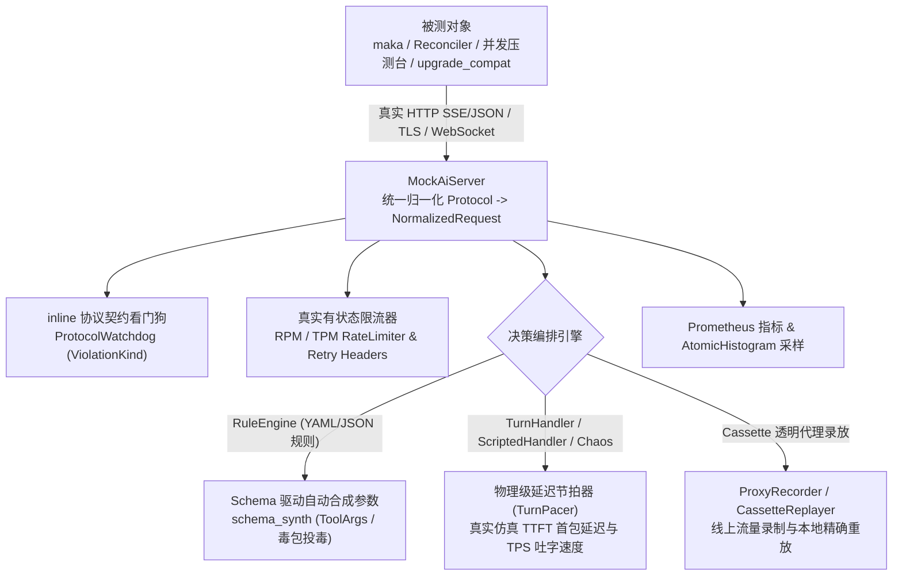
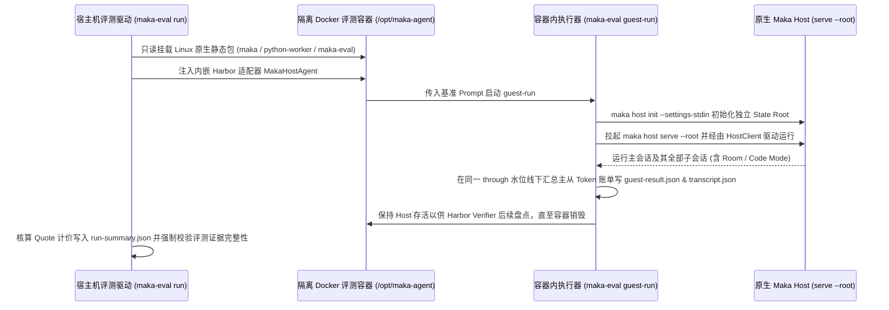

# 端到端基准评测与高并发 Mock AI 测试引擎

## 1. 为什么传统 `if/else` 单元测试与盲目连真实 API 跑压测都不可持续？

一个具备 Reconciler、流式网络网关、Code Mode 沙箱、OS 隔离容器以及多智能体 Room 协作的生产级微内核，最脆弱的往往不是单个算法函数，而是“真实黑盒链路上的诡异时序组合”：
- 如果模型在流式输出第 12 毫秒吐出一个工具参数刚吐到一半，TCP Socket 突然被 RST 截断、或者遭遇服务端隐式 Context Overflow 报错、或者连续触发 429 RPM/TPM 速率惩罚、甚至 WebSocket 长连接半途切换失效，系统能不能按预期降级而不丢工具收据？
- 对每个 PR 直接用真实商用大模型跑上万次长工具链集成测试和并发压测，不仅费用惊人、速率受限死，更无法精确稳定复现“第 3 步吐半截坏包 + 第 4 步网络丢包”这种微秒级混沌故障。
- 而把验证完全简化成“Mock 一个返回固定文本的假客户端接口”，又根本绕开了真实网络传输层、`CaptureArena`、权限控制、SQLite `writeback` 以及计费精度链条。

Maka Rust 仓库自研并内置了两套形成完美互补的工业级验证重器：**用于高并发协议混沌仿真与零成本压力测试的 `tools/mock-ai`（`maka-mock-ai`）**，以及 **用于在 Docker 隔离沙箱内对完整二进制宿主进行真实智能体能力审计的 `products/eval`（`maka-eval`）**。

---

## 2. 精密大模型仿真网关：`maka-mock-ai`

翻阅 `tools/mock-ai/src/lib.rs` 可见，`maka-mock-ai` 绝非普通的 Mock HTTP Stub，而是一整座完整还原商用推理网关物理行为的**高并发多协议仿真基础设施**：

### `maka-mock-ai` 的六大硬核工程特性

| 核心子模块 | 模拟与校验能力 | 对验证 Rust 微内核的不可替代价值 |
| :--- | :--- | :--- |
| **全真多协议同构与 WS 局部连接状态** | 同时讲 OpenAI Chat Completions（SSE/JSON）、OpenAI Responses（SSE/JSON + **带连接级 `store:false` 状态的 WebSocket**）、Anthropic Messages 以及模型控制面端点 | 原汁原味压测 `maka-model` 的每一条原生适配器分支，特别是极具风险的 OpenAI Responses WS 增量状态前缀校验与 5 分钟冷却退避逻辑 |
| **内联协议看门狗 (`ProtocolWatchdog`)** | 实时在线审计微内核发出的每一帧上行 `NormalizedRequest`，一旦抓到工具 Call/Result 未闭环、角色交替违法或非合法增量跳跃立刻登记 `ViolationRecord` | **不等大模型报错，协议端当场就能把任何 `canonical_prompt` 历史投影错位与孤儿工具呼出抓住现行** |
| **物理节奏与限流模拟 (`TurnPacer` & `RateLimiter`)** | 基于真实 TTFT（首词元时间）、TPS（每秒词元速率）的帧级时间轴控制（`ScenarioSchedule`），搭配有状态 RPM/TPM 桶与标准限流响应头 | 精确验证 250ms 租约观测、`StreamCleanupError` 在中途取消高慢速长流时的行为表现，以及退避策略 `Retry` 是否真按服务端建议休眠 |
| **JSON Schema 工具参数合成与混沌投毒** | 通过 `synthesize_tool_arguments` 根据请求里携带的 Tool JSON Schema 动态合成合法测试参数，或通过 **`WirePoisonConfig` / `poison_sse_frame` / `context_overflow_error` / `MidStreamErrorSpec`** 在流传输精确点位投喂断帧或溢出报错 | 在单机百毫秒内可重复触发如 `Attempt::compactable_overflow()`、截断参数 `OUTPUT_LIMIT_TOOL_REJECTION` 与半程断网等极罕见生产惨案 |
| **透明磁带录制与回放 (`proxy` / `Cassette`)** | 支持作为透明 TLS/WS 代理（`UpstreamWsStream`）录制真实大模型的线上复杂多轮交互为 Cassette 磁带，并在本地按匹配规则精确重放或做时间节拍回放（`TimedChunk`） | 让真实昂贵的线上复杂 Bad Case 一经捕获便可永久化身为毫秒级零成本 CI 回归用例 |
| **高并发混沌负荷制造器 (`WorkloadGenerator`)** | 结合 `ChaosConfig`、YAML 宣告规则引擎与 Prometheus 指标导出，可直接驱动全套 Host 执行千并发级别压测 | 提前暴露 SQLite `writeback` 单写者背压极限、`CaptureArena` 内存切文件阈值拐点与资源泄漏盲区 |

---

## 3. 真实环境容器级基准评测：`maka-eval` 与 Harbor 整合

模拟服务器能彻底扫清微内核工程 Bug，但模型与整个 Agent 运行时在真实代码库解决复杂工程问题时的端到端战斗力（例如 Terminal-Bench / SWE 任务通过率、多子会话协作成本核算与完整审计轨迹完整性），依然需要靠真实 Docker 容器内的标准化 benchmark——即 **`products/eval`（`maka-eval`）** 对接 **Harbor** 基准框架来完成。

### `maka-eval` 中极具参考价值的三大防作弊与严谨计量设计

查看 `products/eval/README.zh-CN.md` 描述的评测生命周期，处处体现出工程团队在真实打榜基准中积累出的深刻踩坑经验：

1. **只读隔离宿主二进制注入与原生驱动链路**：
   容器启动时将预编译好的精简 Linux 原生可执行文件集（`maka`、`maka-python-worker`、`maka-eval`）以**只读权限直接挂载进容器 `/opt/maka-agent`**，`maka-eval guest-run` 在容器内部依托标准的 `maka host init` + `maka host serve --root` 与 `HostClient` / `maka-app-client` 驱动完整真实会话跑批——**评测跑的不是一套阉割简化版脚本接口，而是和生产桌面端完全同源的 Rust 微内核本体**。
2. **统一 `through` 水位线下的跨子会话无漏单计量（`metering`）**：
   一旦 Agent 在复杂基准任务中动用了多个子会话并发干活，粗糙的统计很容易漏算子孙节点的开销。`guest-run` 严格在**同一一致的历史水位线 `through`** 下汇总根会话及其衍生的全部子会话用量；外部 `maka-eval run` 再逐请求套用精算 `Quote` 计价规则导出 `run-summary.json`，并且诚信标明计费完整度枚举：**`complete`（全部覆盖核算精准）** 或 **`lower_bound`（局部缺失仅作下界参考）**（若计价异常则显式暴露 `meteringError`），绝不用残缺数据强行粉饰成本报表。
3. **清醒的三态结局划分与判分期进程护航（`GuestRunResult`）**：
   评测明确把结案结果划分为：
   - **`infraFailed`**：宿主机、容器环境或传输底座基础设施自身故障（直接中止判定环境无效）；
   - **`subjectStopped`**：被测 Agent 因为策略拦截或能力边界主动中止（交由 Harbor Verifier 验证残局）；
   - **`completed`**：Agent 顺利完结任务（注意文档点破的关键细节：**即便任务完结，容器内的 Host 与伴随后台服务依然保持存活状态直到 Verifier 彻底打分完毕、容器销毁为止，绝不会提前把刚刚由后台服务起起来的本地被测 Web/API 进程一并误杀而导致 Verifier 验证失败！**）。

---

## 4. 总结

纵观 Maka 的测试与质量基础设施，它回答了一个极其现实的系统难题：**高复杂度异步微内核的工程可靠性，绝对不是靠堆砌手工 E2E 肉眼点检得来的，而是靠“两把截然不同的专业手术刀”精确剖开的**：
- 对内边界与极端网络故障靠 **`maka-mock-ai`**：内置 `ProtocolWatchdog` 在毫秒间抓出协议违例、靠混沌投毒与连接级 WS 状态模拟把几百小时生产才会撞到一次的边缘竞态变成日常 `cargo test`；
- 对外真实能力与系统代价靠 **`maka-eval`**：把完整原生 `maka` 内核放进只读容器与 Harbor 对齐，`through` 同水位线精算全部子孙会话费用并用三态判别守住 Verifier 判分现场。

读完这最后一章基础设施，我们已经全面走遍了 Maka Rust 微内核的六大架构支柱。在全系列教程的最末端，我们有必要退后一步，把时间与空间轴拉通：**同属于 Maka 体系的“TypeScript 混合架构前代（`maka-agent-infra`）”与“Rust 原生微内核重构版（`maka-rust-agent-infra`）”放在一起横向对照，究竟演进了什么、保留了什么灵魂、两套设计模式又分别最适合什么样的工程团队与产品形态？** 下一篇全系列终章为你全景复盘——[架构演进全景对照：从 TypeScript 混合体到 Rust 微内核](./rust-vs-ts-evolution.md)。
