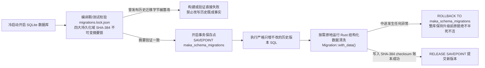

# 持久化迁移锁与时间胶囊升级验证体系

## 1. 为什么桌面与本地 Agent 应用对 Schema 演化零容忍？

Web SaaS 后端发布新版本时，运维人员可以通过灰度发布、维护停机窗口和后端手工 SQL 修复来处理数据库迁移异常。但本地安装的智能体平台完全没有这套兜底条件：
- 用户把半年前某个旧版本跑出来的长会话、历史房间（Room）、未结清 `RecoveryRef`、记忆账本（Memories）和可移植代码检查点保存在个人笔记本的磁盘里；
- 某天终端用户一键自动更新到了新版 `maka` 二进制程序并直接双击冷启动——**它必须在无人工 DBA 干预的情况下，零差错、零损毁、原地在事务内把半年前那套旧数据结构平滑升级到最新模型，并且能原封不动继续运行那场停留在半途的会话！**

在很多软件仓库里，开发者改完数据库代码后，往往顺手去修改三个月前那条已经发布过的 SQL 迁移脚本，或者在重构 JSON Payload 结构时漏掉老历史记录里的某几个兼容反序列化字段，结果新代码自己跑单测全绿，老用户一升级立刻触发冷启动崩溃或静默丢状态。

Maka Rust 微内核在 `AGENTS.md`、`platform/event-log/src/migration.rs` 以及 `products/maka/cli/tests/upgrade_compat.rs` 中，将持久化状态升级提升为了**由加密摘要锁死、事务保存点保护、且受 CI “时间胶囊（Time Capsule）”回放测试硬性校验的第一优先级架构防线**。

---

## 2. 不可变迁移基石：`SAVEPOINT` 内原地迁移与 `migrations.lock.json` SHA-384 锁

查看 `platform/event-log/src/migration.rs` 可以看到，整个持久层迁移机制围绕**原子不可分、防私改与数据/结构同事务清洗**三项铁律打造：

### 拆解四项核心防线机制

1. **四大持久存储域全覆盖的不可变摘要锁（`migrations.lock.json`）**：
   Maka 将覆盖 **`event-log`**、**`agent/state`**、**`settings/store`** 与 **`cli/deployment`** 四大核心持久库的全部历史迁移登记于 `migrations.lock.json`，使用 **`SHA-384`** 校验摘要死死锚定每一条已发布的迁移脚本精确字节序列（`checksum(sql)`）。一旦任何历史脚本被改了一个空格，账本校验当场报错拒绝执行，彻底封堵“事后暗改旧迁移”的工程坏习惯。
2. **结构迁移与业务数据重整的原子捆绑（`Migration::with_data`）**：
   真实系统的演化极少只靠加一列 `ALTER TABLE ... ADD COLUMN` 就能搞定，往往需要对旧版本序列化的紧凑 JSON Payload 或状态字段做结构化迁徙重构。`Migration` 结构体原生提供 `with_data: Option<MigrateData>` 钩子，保证 Rust 层清洗旧数据的函数必须在 **`sql` 执行之后、迁移账本入库之前，严格嵌套在同一个 `SAVEPOINT maka_schema_migrations` 内部同步跑完**——要么全盘新老贯通、要么整段无缝回滚，绝不存在“表结构已变、旧数据格式烂在表里”的中间死态。
3. **重开连接自动挂接注册函数（`with_configure`）**：
   针对依赖 SQLite 自定义派生函数或检索触发器的表结构，`with_configure` 保证每次重新打开 Writer 连接都必须先行配置注册环境，避免冷重启后再写数据时触发函数缺失异常。
4. **权威事实与可重建派生索引的物理边界隔离**：
   依据 `AGENTS.md` 的规定，Maka 将全部索引划分为不可侵犯的**权威事实源（Authoritative Facts）**与**可丢弃可重算的派生索引（Derived Indexes，如 Recall 召回索引与 FTS 全文索引）**。如果某次大版本改动调整了分词、权重或检索视图拓扑，升级脚本可以直接清空并标记延迟重放原始 `Fact` 流重铸派生索引，而不必冒险去大手术修改沉重的历史核心记录。

---

## 3. “时间胶囊”跨代回放验证：`upgrade_compat.rs`

仅仅靠单元测试在内存中临时建个新库、按顺序跑完 `v1 -> v2 -> ... -> vN` 是不够真实的——因为真实生产历史库里充满了多方交错的复杂资产：多模态附件、挂起中的审批、分叉会话、`Room` 多方讨论记录、`SubagentPreset`、以及停在半途的 `SessionData`！

Maka 在 `products/maka/cli/tests/upgrade_compat.rs` 中打造了一座精密的 **“时间胶囊（Time Capsule）”全场景前向兼容测试工坊**，支持三种精准运行模式：

| 运行模式 | 触发方式 | 执行逻辑与验证深度 |
| :--- | :--- | :--- |
| **本地闭环快检 (Default)** | 不设环境变量直接跑测试 | 使用当前二进制当场造出一整套复杂状态胶囊，并立即克隆副本模拟冷启动、全量反序列化清扫与续跑校验 |
| **封装历史胶囊 (`Produce`)** | `MAKA_COMPAT_PRODUCE_CAPSULE=<dir>` | 拉起目标历史版本二进制 `MAKA_COMPAT_BIN` 跑完整复杂业务流，封存整套 State Root、隔离 `$HOME`、Portable 检查点以及描述文件 **`capsule-manifest.json`** 到归档目录 |
| **跨代升级校验 (`Verify`)** | `MAKA_COMPAT_VERIFY_CAPSULE=<dir>` | 把由半年前或上一主版本封存的历史胶囊拷贝至临时区，换用**最新编译的 `maka` 二进制**强行冷启动加载它，运行三大严苛体检 |

### 胶囊解冻后的三大终极体检

在 `Verify` 模式下，新二进制接管老 State Root 后必须依次硬扛过以下全部验证才算通过：
1. **冷启动原子迁移**：所有数据库在不丢失一笔旧状态的情况下完成就地 Schema 与 `with_data` 数据重整升级；
2. **全量持久域穷举反序列化扫雷（Exhaustive Deserialization Sweep）**：遍历每一个核心持久表（会话配置、事件流、记忆、Presets、Rooms、工作区绑定、附件与检查点），强行用新版 Rust `#[serde(deny_unknown_fields)]` 严格模型重新完整读取反序列化一遍——**只要有一个字段改坏了向下兼容约定，当场触发编译/测试爆炸红灯！**
3. **跨代活体接力续跑（Live Continuation）**：不仅要“读得出来”，还要证明老东西“能继续干活”！测试驱动器会在升级后的老库上直接更改新设置、延续原来的旧对话、**用新版 Code Mode 接着读取升级前存进来的 `SessionData` 变量**、往旧 `Room` 发新消息、检验 Recall 索引重建并收尾跑全套 SQLite 完整性校验。

配套 CI 流水线（`compat-post-merge.yml` 与 `nightly.yml`）在每次合入后和每日夜间持续抽取过往真实发版封存的时间胶囊执行回归验证，真正做到“向前每走一步，背后老用户的路都在被全自动守护”。

---

## 4. 总结

Maka Rust 微内核对待持久演化的态度可以浓缩为一句话：**把向下兼容性变成无法靠口头承诺侥幸蒙混的编译期和 CI 硬门禁**。
- `migrations.lock.json` 用 SHA-384 把“不可逆前向演进”变成刚性定律；
- `SAVEPOINT` + `Migration::with_data` 把复杂老数据的结构洗牌保护进单一事务边界；
- 而 `upgrade_compat.rs` 的时间胶囊架构确保每一个大版本变更在合并前都真正“穿过历史、活到新版并接着正常干活”。

守住了“昨天老状态怎么活到今天”之后，工程化还剩下最后一个关键检验维度：**“今天写出来这套复杂的并发 Runtime 与工具流水线，在几千次高压并发与诡异网络截断面前到底有多抗造？上线前怎么客观评测整条 Host 在真实容器里的端到端解决率与每一分钱消耗？”** 下一篇直击 Maka 的测试模拟工厂与真实评测引擎——[端到端基准评测与高并发 Mock AI 测试引擎](./evaluation-and-mock-ai.md)。
