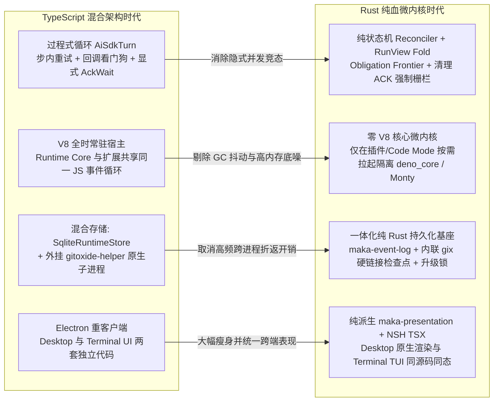

# 架构演进全景对照：从 TypeScript 混合体到 Rust 微内核

## 1. 两次顶层架构跨越：一次“从生态敏捷向系统主权”的重铸

在本仓库的 `docs/agent-infra/` 中，我们完整解剖了同一个顶尖 Agent 基础设施平台（Maka）前后两代截然不同却又一脉相承的工程架构：
- **前代主力路线（[TypeScript 架构版](../../maka-agent-infra/README.md)）**：以 Node.js + Electron TypeScript Monorepo 承担控制面与业务循环（`AiSdkTurn`、`SessionManager`、`ToolRuntime`），并在性能与系统安全敏感点下沉部分原生 Rust 辅助进程（`native/gitoxide-helper`、`native/runtime-host-peer`）。
- **最新演进路线（[Rust 微内核架构版](../README.md)）**：全面以纯 Rust、零常驻 V8 的硬核微内核统领平台层、Agent 状态机（`Reconciler` / `RunView`）、`Event-Log`、`maka-model` 与 OS 原生沙箱（Microsoft MXC / `bubblewrap` / Seatbelt），仅把外部业务扩展、Code Mode 脚本与双宿声明式界面（NSH TSX）剥离在隔离沙箱与契约边界之外。

理解这两代架构之间“**什么变了、什么没变、以及为什么非变不可**”，比单纯背诵任何一段源码 API 都更能帮助架构师在自己的项目里做出清醒的技术选型。

---

## 2. 一脉相承的内核信条：两代之间从未动摇的工程底线

尽管编程语言与物理运行模型发生了天翻地覆的重塑，Maka 团队经过大量线上真实踩坑沉淀下来的核心安全与可靠性底线，在 Rust 微内核中不仅一字不落得以延续，甚至进一步被硬化进了编译器类型检查之中：

| 不变的工程原则 | TypeScript 前代架构版中的表现 | Rust 微内核版中的进化强化 |
| :--- | :--- | :--- |
| **唯一持久化权威原则** | 单一 Host 独占写入 State Root，`SqliteRuntimeStore` 串行化提交 | 收敛为唯一 `RootOwner` / `RootStore` + `writeback::Statement` 单写者 FIFO，硬性规定**提交前零通知/令牌逃逸** |
| **Responses WebSocket 窄门增量** | Turn 级增量 WS 复用、严格前缀比对、`hasRequestCustomization` 绕过与 5 分钟冷却 | 完整继承进入 `maka-model` 原生网关，并叠加 `ModelCleanupObserver` 物理流停机可观测校验 |
| **PDF 与多模态防瞎重试** | 无结构化拒绝诊断绝不默默丢弃附件重跑 | 通过 `runtime-pdf-rejection-recovery` 与冻结准备期 `CaptureArena` 资产契约彻底制度化 |
| **工具与结果不可篡改账本** | `ToolResultArchive` `maka://` 卸载读取 + 封存未知态避免卡死压缩 | 升格为 `maka://session/<id>?through=...` 跨会话协议 + **`Tool::outcome_unknown_accepted()` 铁律锁定时间线** |
| **宿主控制外置执行体边界** | `PluginRuntime` + `AgentBackend` 对接外部 ACP 代理 | 深入演化为 `acp-executor` + `Codex/Claude/AntigravityAcp` 原生提示词保留（`<maka_system_instructions>` 摘要增量同步）+ `TaskOwner` |

---

## 3. 核心架构分水岭：八大系统性演进对比

如果说“守住了什么”代表工程经验的传承，那么下面这张架构演化表，则清晰展示了“为什么原架构不够用了”以及 Rust 微内核通过哪些结构性跃迁完成了降维重构：

| 演进维度 | [TypeScript 架构版](../../maka-agent-infra/00-foundations/architecture.md) | [Rust 微内核版](../00-foundations/architecture.md) | 架构跃迁的核心本质 |
| :--- | :--- | :--- | :--- |
| **1. 运行时控制流模型** | `AiSdkTurn` 过程式双重 `while` 循环配合 `waitUntilConsumed()` 死等确认（详见 [TS 01.1](../../maka-agent-infra/01-runtime/model-step.md)） | 纯函数 `reconcile::next()` 扫描 `RunView` 与 `Live` 状态机；所有停顿收拢为 `WaitReason`；任何退出必过 `OperationCleanup::Confirmed` 栅栏（详见 [Rust 01.1](../01-runtime/reconciler-and-obligation-frontier.md)） | 从“依赖协程不跑飞的过程式协调”彻底蜕变为**随时可卸载内存、断电可幂等追账的声明式调谐器** |
| **2. V8 与语言运行时边界** | 主内核本身就在 Node.js V8 中运行 | **Core Engine 纯 Rust 零 V8**；JS 宿主插件走独立 `maka-host-js` 隔离 Realm，代码单元格走 `deno_core` / `Monty` 子进程与 `SessionDraft` 原子持久化 | 把“业务可扩展性”与“核心稳定性/低资源开销”物理隔离，告别整个主控被第三方插件内存炸毁 |
| **3. 跨回合大负载上下文组装** | 内存 JSON 数组拼接 + 截断摘要 + `ModelProjectionTransitionLedger`（详见 [TS 02.1](../../maka-agent-infra/02-context/history-and-projection.md)） | **`CaptureArena`（驻留内存 / 文件背书平滑降级）+ 32 KiB 预算分片 + 160B 定长 `Record` 流式组装** + 85% 后台抢跑主动摘要 | 将峰值内存锁在严格 `BudgetBasis` 上限之下，彻底消除多模态重负载与大工具流带来的 GC 停顿和 OOM |
| **4. 多智能体协同拓扑** | 以有向委托与消息通知流为主的局部会话扩展体系（详见 [TS 05.1](../../maka-agent-infra/05-coordination/agent-graph.md)） | 统一 **七元对称 `Session*` 工具** + 原生 **`Room` 群聊账本（`@mentions` 定向路由 + `replyTo` + `RoomContextSnapshot`）** + `SubagentPreset` CAS 版本库 | 让平级多角色协同与嵌套汇报复用唯一一套对称认知原语，同时借助 `@mentions` 制度性杜绝 Echo Storm 费用风暴 |
| **5. 操作系统安全沙箱深度** | 双路隔离 Worker 进程 + macOS/Linux 基础沙箱 + Windows Task Launcher（详见 [TS 03.4](../../maka-agent-infra/03-tools/sandbox.md)） | **原生 Windows Microsoft MXC**（零 UAC、零账号污染、零 ACL 改写）+ Linux `bubblewrap`/netns + macOS Seatbelt + **可写域可逆占位守卫** + Fail-Closed | 直接吃透三大桌面操作系统内核级最轻量隔离红利，免去烦人环境安装与不可逆权限后遗症 |
| **6. 权限凭证语义哲学** | Host `AccessAuthority` 与会话作用域准入检查 | 系统级消灭任何可携带离线通行的 **Bearer Capability**；强制所有副作用瞬间经过 **`authorization` 四维实时重检** + `ExecutionAuthority` 250ms/5s 心跳租约 | 把防止混淆代理人（Confused Deputy）和僵死执行器越权的安全防线写进每一份核心数据结构注释与检查逻辑 |
| **7. 界面与跨平台载体** | Electron + 独立终端 CLI 实现 | **`maka-presentation` 只读行投影 + NSH（TSX -> Desktop AppKit/Direct2D/GTK 与 Terminal Ratatui）** | 一套声明式业务工作台编码同时服务原生硬件加速桌面与远程纯终端，且彻底切断 UI 渲染状态污染模型认知通道 |
| **8. 演化验证与基准生态** | TypeScript Jest/Vitest 单元测试 + Docker Harbor Eval | **`migrations.lock.json` SHA-384 不可变锁 + `upgrade_compat.rs` 时间胶囊全代际回放 + `maka-mock-ai` 内联协议看门狗混沌网 + `maka-eval` Harbor** | 建立了覆盖协议规范、并发时序、极端网络混沌到十年跨版本数据升级防炸库的工业级闭环防线 |

---

## 4. 选型指南：如果你要从零建造或演进自己的 Agent 基础设施，该走哪条路？

读完这两套总数近 60 篇的硬核架构拆解后，面对自己正在孵化的新系统，你应该如何取舍？这里有一份极其清醒的工程决策罗盘：

1. **如果你的团队正处于 0 -> 1 验证期、核心优势在于快速迭代各种垂类场景工具、且主要跑在受管云端 Linux 容器里**：
   - **优先参考 [TypeScript 架构版](../../maka-agent-infra/README.md)** 的逻辑骨架！全栈单一异步脚本语言让开发迭代效率极高，但**务必把其中验证成功的模式直接抄进骨架里**：比如单个 Host 独占 SQLite 写锁、绝不混改历史事实与 UI 视图、Tool 的 `OutcomeUnknown` 锁死防覆盖、以及把 Git 与长二进制传输局部剥离给轻量 Rust CLI Helper。
2. **如果你要打造的是一款直接安装在百万研发人员个人 Windows / macOS / Linux 电脑上的长期常驻桌面生产力引擎、企业本地安全网关、或者需要同时整合 Claude/Codex/自有模型的高并发自治平台**：
   - **请毫无犹豫地对标 [Rust 微内核架构版](../README.md)** 的分层设计理念！
   - 你最应该优先落地吸收的五颗核心钻石分别是：
     1. **`Reconciler` + `Obligation Frontier`**：哪怕暂时不写 Rust，用任意语言把“纯状态评估函数 `reconcile::next()`”与“带异步副作用执行体”劈开，也能帮你消灭 90% 的超时、打断和重启恢复 Bug；
     2. **`Outcome` 与 `Cleanup` 分离 + 清理强制栅栏**：千万别让一个看似 Completed 的 Turn 背后还拖着几个没关掉的后台子进程、半开的 Browser Lease 或未释放的文件句柄；
     3. **拒绝 Code Mode 快照与重放**：用 `SessionDraft`（纯可序列化状态 + 已装载工具清单）+ 仅计纯同步 CPU 时间的预算表，省下以后无数跨版本迁移与重放致灾的噩梦；
     4. **非持有型能力模型（消灭 Bearer Token）**：每一次真改动物理世界前的“四维实时重检” + 短周期 `ExecutionAuthority` 心跳，是防止长程后台 Agent 变成“无监管僵尸破坏者”的唯一物理锁；
     5. **`maka-schema` 单一真理出口与“时间胶囊”迁移验证**：当系统还没长太胖时就立下“绝不修改已发布旧迁移”、“一切结构变更必须带实库历史回放自证清白”的铁律。

---

## 5. 结语：关于好的系统架构

真正顶级的 Agent 基础设施，外表看起来往往并不依赖多么晦涩炫技的“奇技淫巧 Prompt”；相反，它越来越像一台冷静克制、职责分明、每一层都敢对上下游说出“**这部分权利我不认、也不给你**”的微型操作系统内核：
- Reconciler 不管具体怎么做 I/O，只盯着未决义务前沿做冷血数学裁决；
- UI 展示视图与内存 CaptureArena 只做只读消费与受控打包，绝不反向涂改哪怕半行历史真相；
- 沙箱与能力层绝不发一张可以到处转借的永久 VIP 通行证，到了门口一切现场重检、条件不齐当场 Fail-Closed。

当底层这些确定性的金属齿轮咬合严密之时，大语言模型极具创造力却又充满不确定性的智能之火，才真正拥有了一副能够安全承载长程重托的钢铁躯壳。

---

*全书完。返回 [Rust 微内核版总目录与导览](../README.md)，或前往 [TypeScript 架构版总目录](../../maka-agent-infra/README.md) 对比阅读。*
