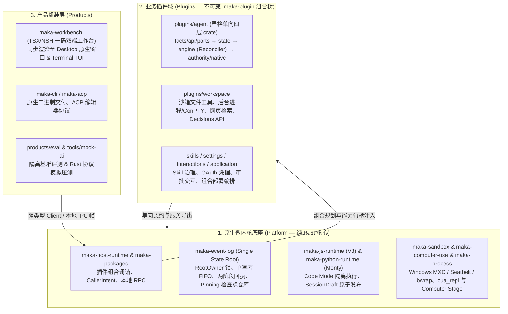
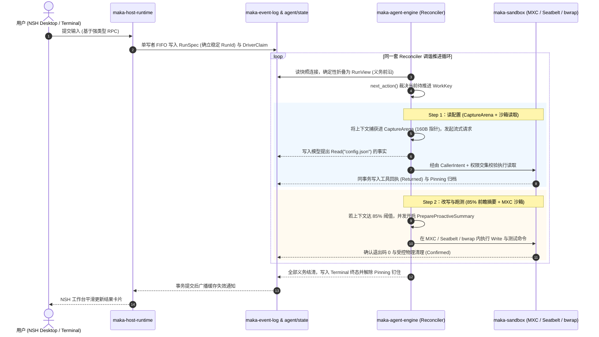

# Maka Agent 基础设施教程（Rust 微内核版）

本教程系统性拆解 **Maka（Rust Edition 2024 微内核 + 插件组合平台版）** 的核心架构、设计哲学与底层实现机制。本手册独立成套，与 [TypeScript 架构版](../maka-agent-infra/README.md) 共同构成 Maka 跨代演进的完整技术图谱；通用教学原理解析另见 [Agent 基础设施教程](../README.md)。

当 Agent 从单机玩具演进为承载多界面协同、热插拔插件、嵌入式多语言代码执行、桌面视觉控制与企业级操作系统隔离的生产平台时，如何打破“状态机逻辑写死在进程循环里、在线与崩溃恢复写两套代码、桌面端与终端各维护一套 UI、扩展与核心互相耦合”的僵局？

Maka 在这一代给出了彻底的架构回答：**以 Rust 编写零耦合的微内核底座（`Platform`），以单向依赖分层的业务领域包构建能力（`Plugins`），以 NSH 原生渲染引擎实现桌面窗口与终端的“一码双端”（`Products`），并用单一的确定性调谐器（Reconciler）统一在线推进与冷启动恢复。**

---

## 1. 全景架构：Platform + Plugins + Products 三层体系

### 核心工程突破速览

相比早期 TypeScript 单体内核，Rust 微内核版实现了十项具有里程碑意义的架构跃迁：

| 突破性设计 | 解决的核心工程难题 | 核心原理机制 | 对应章节 |
| :--- | :--- | :--- | :--- |
| **统一 Reconciler 与义务前沿** | 消除“正常执行写一套循环、崩溃恢复再写一套补丁”的分叉 Bug | 将所有事实折叠为 `RunView`（义务前沿），在线推进、审批、重试、压缩与冷启动恢复全走 `reconcile::next_action` 同一循环，跨重启保持稳定 `RunId`。 | [01.1](01-runtime/reconciler-and-obligation-frontier.md) |
| **`Outcome` / `Cleanup` 分离与 `Pinning`** | 解决本地事务与外部副作用撕裂、以及未结清资源被 GC 误删 | 变更前落盘 `CallerIntent`；回执将业务 `Outcome` 与物理 `Cleanup` 分离并单调推进；活跃 Run 与 `Unknown` 操作自动钉住关联的内容寻址对象。 | [04.1](04-state/event-log-and-two-phase-ops.md) |
| **`CaptureArena` 零堆拷贝竞技场** | 避免含高清图片与巨量上下文的请求在重试时堆内存爆炸 | 规范消息捕获进 160 字节固定记录指针指向的字节竞技场（`SourceBytes::Source`），重试与重放直接流式读盘。 | [02.1](02-context/capture-arena-and-projection.md) |
| **85% 阈值前瞻摘要 + 截断限流** | 消除上下文临近爆窗时的阻塞卡顿与长度截断无限死循环 | 达 85% 窗口后台并发启动 `PrepareProactiveSummary`；单次运行最多允许 3 次输出截断续写，且严禁执行被截断的残缺工具参数。 | [01.3](01-runtime/model-protocol-and-streaming.md)、[02.2](02-context/proactive-compaction-and-media.md) |
| **V8 + Monty 双引擎 Code Mode** | 限制脚本 CPU/堆配额的同时不误杀等待慢速工具调用的时间 | `deno_core` V8 Isolate 与 Monty Python 子进程；30s 超时仅计同步 VM CPU 时间（剔除异步 Host 工具等待）；不做堆快照，通过 `SessionDraft` 原子提交 `SessionData`。 | [03.1](03-tools/code-mode-v8-and-monty.md) |
| **Windows Microsoft MXC 原生沙箱** | 终结 Windows 下配低权限账户、改 ACL、UAC 提权的维护噩梦 | 优先调用 MXC 为每棵命令树构建零提权原生沙箱，用可恢复占位守卫处理只读例外，失败立刻熔断绝不裸跑。 | [03.3](03-tools/windows-mxc-and-os-sandbox.md) |
| **`NSH` 一码双端 & `Computer Stage`** | 告别桌面端与终端双倍 UI 维护成本，防截图预览泄露操作控制 | 同一套 TSX 代码渲染至原生桌面窗口（Direct2D/AppKit/GTK）与终端字符/像素屏；`cua_repl` 支持 ChatGPT 扩展按需租约与只读有界 Stage 预览卡。 | [00.1](00-foundations/architecture.md)、[03.2](03-tools/mcp-and-computer-stage.md) |
| **对称 `Session*` 工具与共享 `Room`** | 让模型与人类用完全对等的视角协作多方任务、预设与分支隔离 | `Read("maka://session/<id>")` + 7 个 `Session*` 工具；支持 `@mentions` 的 `Room`、`onComplete: "notify_caller"` 与 Git `worktree` 隔离。 | [05.1](05-coordination/rooms-and-symmetric-sessions.md) |
| **`ExecutionAuthority` 控制面执行权** | 如何在受管环境下强行锁死会话权限上限与多进程平滑交接 | 独立可信控制面每 250ms 观察租约，与工作区权限求交集过滤；计划内交接需经 5s 清理确认方准下一代接管。 | [03.4](03-tools/execution-authority-and-capabilities.md)、[04.2](04-state/checkpoint-repository.md) |
| **SHA-384 锁定迁移与时间胶囊测试** | 避免老版本用户升级数据库后读出残缺历史或并发崩坏 | 禁止改写已发布 SQL 迁移（`migrations.lock.json` 锁摘要），配合 `upgrade_compat.rs` 回放历史时间胶囊验证冷迁移与恢复。 | [06.1](06-operations/migrations-and-upgrade-compat.md) |

---

## 2. 一项任务在 Rust 微内核中的推进全景

以**“读取 `config.json`，将超时时间改为 60 并运行测试验证”**为例，追踪数据如何在微内核各层中流转：

---

## 3. 全书章节目录（共 26 篇）

| 模块 | 章节 | 核心问题 | 学习目标 |
| :--- | :--- | :--- | :--- |
| **00 架构基石** | [00.1 三层微内核与插件组合](00-foundations/architecture.md) | Platform/Plugins/Products 如何解耦？ | 理解内容寻址 `.maka-plugin`、组合规划器、`overrides` 平滑升级与 NSH 一码双端 |
| | [00.2 Cargo Workspace 与单向依赖](00-foundations/repository-map.md) | 60+ Rust Crate 如何防止循环耦合？ | 掌握 `facts/api/ports → state → engine → native` 分层与 `maka-schema` SDK 生成 |
| | [00.3 领域事实与状态折叠](00-foundations/domain-model.md) | `RunId` 为何能跨越重启保持不变？ | 吃透 Newtype 身份宏、`Trigger/RunOrigin`、义务前沿与 `RunView` 同事务折叠 |
| | [00.4 Rust 版十大架构权衡](00-foundations/design-tradeoffs.md) | 为什么用微内核重构替换单体循环？ | 掌握状态折叠、分离式操作日志、无堆快照 Code Mode 与硬链接检查点等取舍 |
| **01 运行时引擎** | [01.1 统一 Reconciler 与义务前沿](01-runtime/reconciler-and-obligation-frontier.md) | 在线执行与崩溃恢复如何共用一套引擎？ | 深入 `reconcile::next_action`、`WorkKey` 任务集合与 `FuturesUnordered` 驱动循环 |
| | [01.2 单驱动租约与 `PendingPublication`](01-runtime/driver-lifecycle-and-admission.md) | 并发提交冲突与晚到回执怎么处理？ | 掌握 `DriverClaim` 围栏、`DriverExit` 四态、`store.observe()` 与快速辅助通道 |
| | [01.3 纯 Rust 协议栈与流式防护](01-runtime/model-protocol-and-streaming.md) | 协议栈如何自愈网络与截断故障？ | 深入 `maka-model`、Responses WS 增量、限 3 次截断保护与 `RetryStreak` 主从切换 |
| | [01.4 V8 HostService 与 NSH UI 插件](01-runtime/host-plugins-and-ui-runtime.md) | JS 后端服务与双端 UI 扩展如何运作？ | 理解 `maka-host-js`、能力句柄注入、`activate(context)` 与热重载状态移交 `prepareReload` |
| | [01.5 外部 CLI 执行器与缓存保护](01-runtime/external-cli-executors.md) | 如何托管 Claude/Codex/Antigravity？ | 掌握 `TaskOwner` 托管与 `<maka_system_instructions>` 单次摘要同步保缓存秘诀 |
| **02 上下文与记忆** | [02.1 `CaptureArena` 与规范投影](02-context/capture-arena-and-projection.md) | 如何在零堆内存爆炸下重放百万上下文？ | 深入 160B 指针字节竞技场、`Read("maka://session/<id>")` 与 `through` 水位线翻页 |
| | [02.2 85% 前瞻摘要与多模态边界](02-context/proactive-compaction-and-media.md) | 上下文如何实现无感后台压缩？ | 掌握 `PrepareProactiveSummary`、Codex 原生压缩回退以及 PDF 拒收不盲目重试铁律 |
| | [02.3 可控记忆、隐私继承与迁移](02-context/memory-and-session-import.md) | 记忆如何绑定证据并可抑制隐藏？ | 学习 `changeMemory.add_evidence`、`Suppress`、`incognito` 继承与外部会话导入 |
| **03 工具与安全沙箱** | [03.1 V8 + Monty 双引擎 Code Mode](03-tools/code-mode-v8-and-monty.md) | 脚本调用工具如何既隔离又防重复副作用？ | 深入 `deno_core` V8 与 Monty 子进程、`CellLimits` 计时剥离与 `SessionDraft` 原子提交 |
| | [03.2 `rmcp`、`cua_repl` 与 Computer Stage](03-tools/mcp-and-computer-stage.md) | 桌面与浏览器扩展如何按需租用并预览？ | 剖析 `cua_repl`、ChatGPT 扩展按需租约、WSL 桥接与有界只读 `Computer Stage` |
| | [03.3 Windows MXC 与跨平台沙箱](03-tools/windows-mxc-and-os-sandbox.md) | Windows 沙箱如何摆脱提权与改 ACL？ | 揭秘 Microsoft MXC 占位守卫、Seatbelt、bubblewrap、代理重定向验证与 ConPTY |
| | [03.4 `ExecutionAuthority` 与能力句柄](03-tools/execution-authority-and-capabilities.md) | 控制面如何强约束运行时权限上限？ | 掌握 250ms 观察轮询、权限上限交集过滤、不可逆撤销与 `maka-capabilities` |
| **04 状态与仓库** | [04.1 `maka-event-log` 与两阶段账本](04-state/event-log-and-two-phase-ops.md) | SQLite 如何扛住高并发读写并防撕裂？ | 吃透 `RootOwner`、FIFO 单写者 + 快照读、`CallerIntent`、分离 `Outcome/Cleanup` 与 `Pinning` |
| | [04.2 检查点仓库与零拷贝硬链接](04-state/checkpoint-repository.md) | 如何零拷贝持久化工作区与历史快照？ | 深入本地硬链接晋升、`FileRepository`、`checkout_exact` 校验与 5s 计划内交接 |
| | [04.3 Host 生命期、IPC 与网络边界](04-state/host-lifecycle-and-transport.md) | 部署状态如何调谐并安全联网？ | 掌握 `maka-host-runtime` 调谐、未变更实例保活、`maka-transport` 与 `maka-network` |
| **05 协同与调度** | [05.1 对称 `Session*` 工具与共享 Room](05-coordination/rooms-and-symmetric-sessions.md) | 多 Agent 如何像人类团队一样协作？ | 深入 7 个对称工具、`Room` `@mentions`、`notify_caller`、`Presets` CAS 与 Git `worktree` |
| | [05.2 持久 Goal、调度器与主动发现](05-coordination/goals-scheduler-and-discovery.md) | Bot 如何自发开展只读调查与长期目标？ | 掌握 `maka-goal`、`WaitId`、统一定时调度与 `DiscoveryComplete` 主动发现机制 |
| **06 运维与演化** | [06.1 不可变迁移与时间胶囊测试](06-operations/migrations-and-upgrade-compat.md) | 跨几十个大版本升级如何保数据不坏？ | 揭秘 SHA-384 锁定 `migrations.lock.json`、`SAVEPOINT` 迁移与 `upgrade_compat.rs` |
| | [06.2 Rust 评测引擎与 `mock-ai` 模拟器](06-operations/evaluation-and-mock-ai.md) | 如何用原生模拟器压测并发与看门狗？ | 深入 `products/eval`、`tools/mock-ai`（模拟 TLS/限流/WS）与客观基准评测 |
| | [06.3 从 TS 到 Rust 微内核的演进全景](06-operations/rust-vs-ts-evolution.md) | 两代架构与 Pi 各自站在什么坐标？ | 全景对比 TS 版 Maka、Rust 版 Maka 与 Pi 的核心演化逻辑与选型准则 |

---

## 4. 建议阅读路径

1. **架构入门**：从 [00.1](00-foundations/architecture.md) 到 [00.4](00-foundations/design-tradeoffs.md) 配合 [GLOSSARY.md](GLOSSARY.md)，快速建立 Rust 三层底座与领域事实的心智模型。
2. **核心内功**：直奔 [01.1 统一 Reconciler](01-runtime/reconciler-and-obligation-frontier.md)、[02.1 `CaptureArena`](02-context/capture-arena-and-projection.md) 与 [04.1 `maka-event-log`](04-state/event-log-and-two-phase-ops.md)，吃透 Maka 最引以为傲的持久化状态机引擎。
3. **硬核系统工程**：重点研读 [03.1 双引擎 Code Mode](03-tools/code-mode-v8-and-monty.md)、[03.3 Windows MXC 沙箱](03-tools/windows-mxc-and-os-sandbox.md)、[03.2 Computer Stage](03-tools/mcp-and-computer-stage.md) 与 [06.1 时间胶囊兼容性测试](06-operations/migrations-and-upgrade-compat.md)。
4. **跨代对比**：通过 [06.3 演进全景对比](06-operations/rust-vs-ts-evolution.md) 完整串联 TS 版、Rust 版与 Pi 三套架构的演进脉络。
